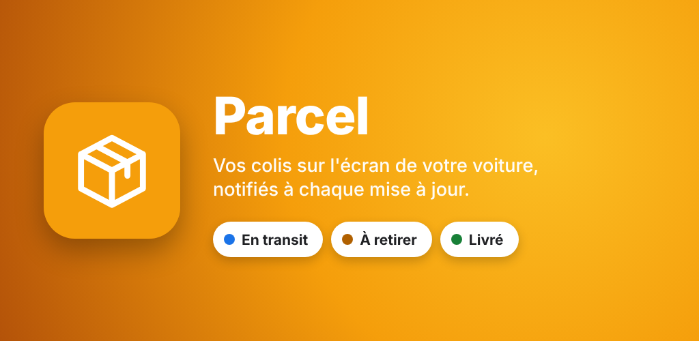
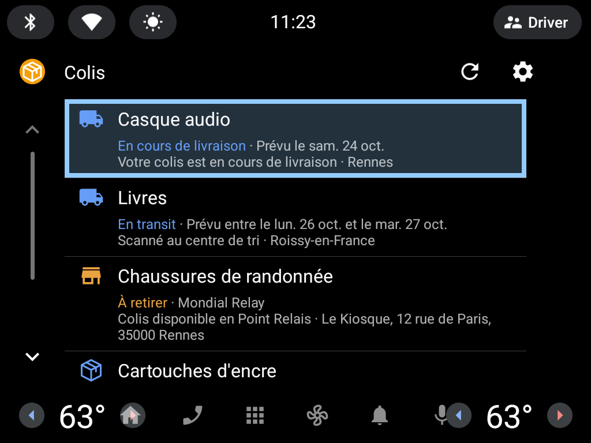
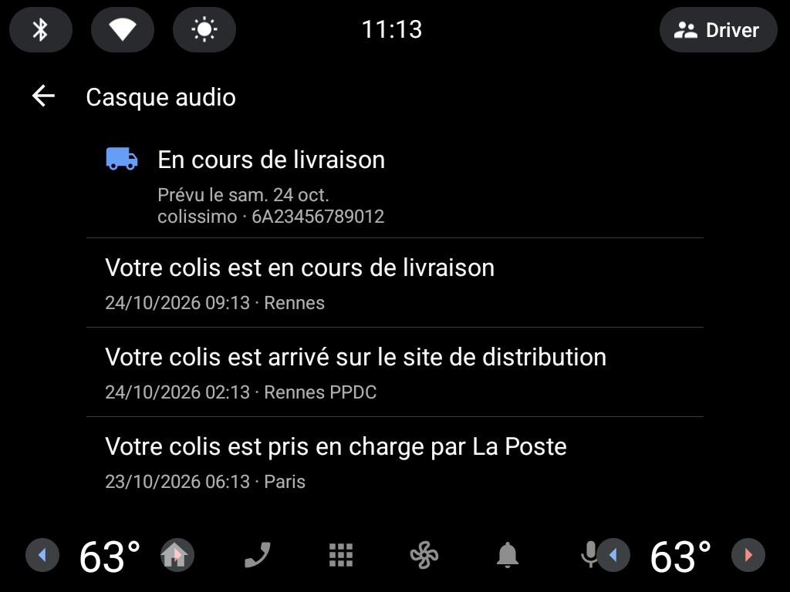
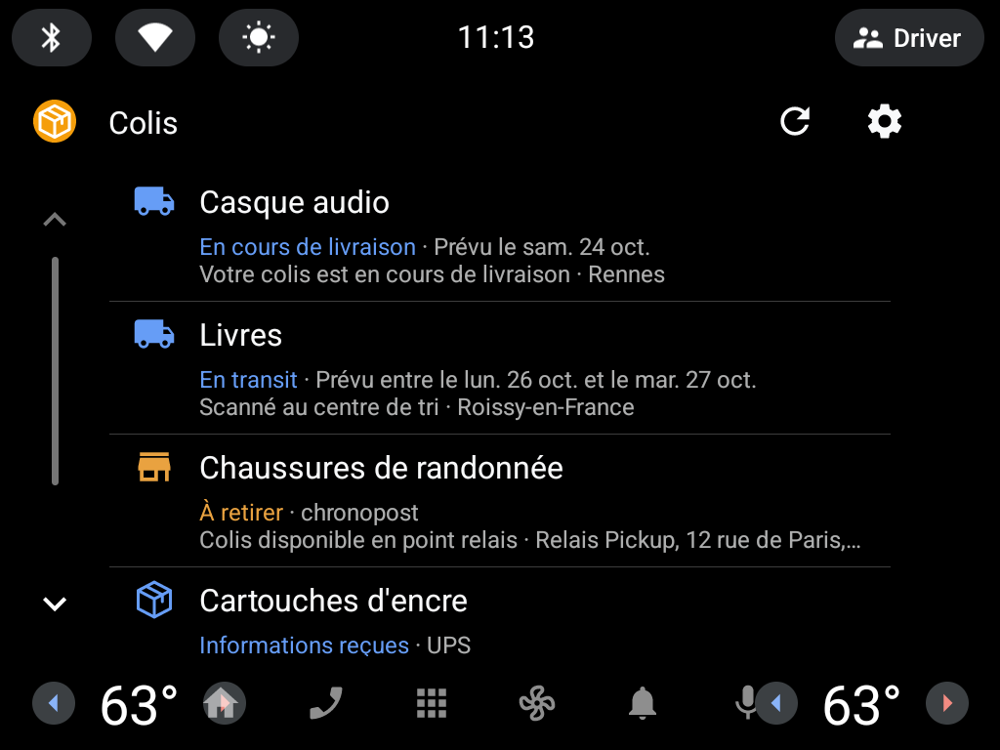
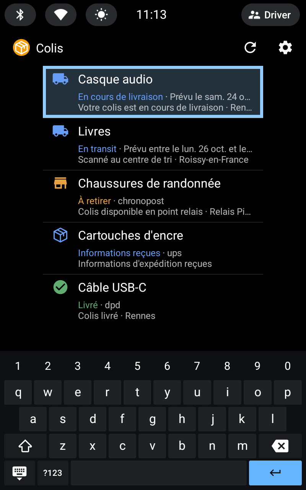
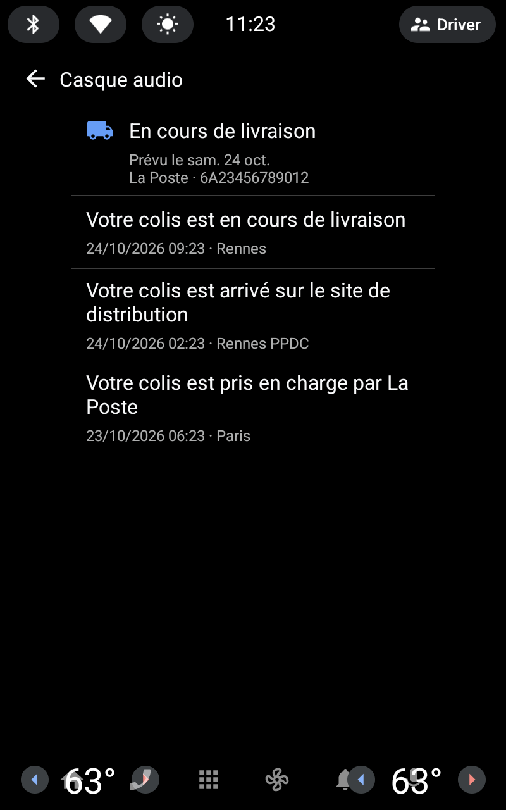
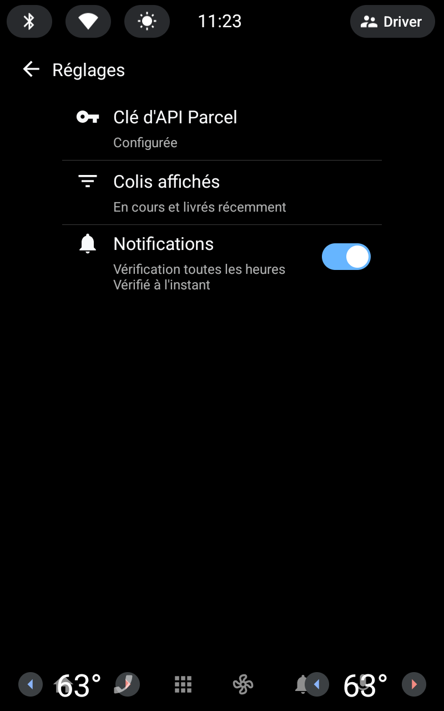

<p align="center"></p>

# Parcel — Android Automotive



[Parcel](https://parcelapp.net) deliveries for **Android Automotive OS 12+** (API 31), built with the
[Car App Library](https://developer.android.com/training/cars/apps) templates (POI category).
**Parked use only**: the app isn't declared distraction-optimized, so the system blocks it as soon as the car
moves; the notifications still arrive while driving.

- Deliveries under way first, by expected date: status in colour, expected date, last event and where it happened
- Optionally the recently delivered ones too (Settings › Deliveries listed)
- Detail: expected date or window, carrier and tracking number, extra information, every event, newest first;
  **Go** hands the pickup point to the car's navigation app when the parcel awaits pickup
- **Hourly check** in the background: one notification per delivery with a new status or event; tapping it opens
  the delivery
- Settings: Parcel API key (checked before it is kept), deliveries listed, notifications on or off
- Demo key `demo`: made-up deliveries with no Parcel account, for a try-out, the emulator run and the Play review

## Screenshots

On the Android Automotive emulator (generic image, templates host), with the demo key. These are the Google Play
listing screenshots, refreshed by running the Emulator workflow by hand with *screenshots*.

| Deliveries | Delivery | Settings |
| --- | --- | --- |
|  |  |  |
|  |  |  |

## Data

Same API and logic as [ha-parcel](https://github.com/juju35/ha-parcel):

| What | Source |
| --- | --- |
| Deliveries, statuses, events, expected dates | Parcel external API, `GET https://api.parcel.app/external/deliveries/?filter_mode=recent` with the `api-key` header, **20 requests an hour** |
| API key | Generated at [web.parcelapp.net](https://web.parcelapp.net) (Parcel Premium); stays on the car, left out of Android backups, only sent to `api.parcel.app` |
| Carrier names | Parcel's public `supported_carriers.json` (no key), daily cache |
| Changes | Each delivery's status and latest event, compared with the previous check (kept on the device) |

The hourly check (WorkManager, with a network, while the car is on) notifies the deliveries that changed; opening
the app shows the last check at once and fetches again after 5 minutes. A new key's own check is the first one, so
the deliveries already there are not notified. The "recent" list is always fetched, so a delivery that turns
delivered still gets its notification; "under way only" just filters the screen.

## Layout

```
app/src/main/java/me/jstephan/parcel/
├── ParcelApp.kt              # notification channel, hourly check schedule
├── ParcelService.kt          # CarAppService + Session (opens a delivery from its notification)
├── Prefs.kt                  # API key (not backed up), filter, notifications
├── data/                     # HTTP, Parcel API client, models, repository (cache + change detection), demo data
├── work/                     # CheckWorker (hourly), Notifier
└── ui/                       # list, detail, settings (ListTemplate), API key (SignInTemplate), setup (MessageTemplate)
```

## Build and run

```sh
./gradlew assembleDebug
```

Test on an emulator from Android Studio's Device Manager with an **Automotive** system image
(Android 12L / API 32 or later, "with Google APIs/Play"). Debug builds accept any templates host;
release builds only the hosts in the library's allowlist. Type `demo` as the API key to try it without a Parcel
account. To run the hourly check without waiting, force its job (WorkManager runs on JobScheduler):

```sh
adb shell dumpsys jobscheduler | grep -A2 me.jstephan.parcel   # JOB #u0a123/<id>
adb shell cmd jobscheduler run -f me.jstephan.parcel <id>
```

On a real car, third-party templated apps are installed through Google Play (internal or closed testing track).

## CI

| Workflow | What |
| --- | --- |
| Lint | pre-commit (whitespace, YAML/XML/TOML, Ruff for `scripts/`), Detekt + ktlint (Kotlin quality, dead code), Android lint, jscpd (duplication). Detekt and Android lint findings go to code scanning, shown on pull requests |
| Build | Debug APK, as a build artifact; Kotlin compiler errors as annotations |
| Emulator | Runs the release build on an Android Automotive emulator with the templates host (landscape and portrait) on each app change, with the demo key; fails on a crash, a template the host refuses, or if the app isn't blocked once the car moves. Run by hand with *screenshots* to refresh the Play screenshots |
| Release | On `main`, when `appVersion` in `app/build.gradle.kts` has no tag yet: signed APK + App Bundle, notes from `CHANGELOG.md`; upload to Google Play when its secret is set |
| Update release notes | Rewrites a release's notes from `CHANGELOG.md` (input `tag`) |
| Clean up merged branches | Deletes merged branches after each pull request and weekly |
| Stale | Marks and closes inactive issues and pull requests |

Release signing uses the repository secrets `SIGNING_KEYSTORE_BASE64`, `SIGNING_STORE_PASSWORD`,
`SIGNING_KEY_ALIAS` and `SIGNING_KEY_PASSWORD`; without them the release is signed with the debug key
(emulator / adb only, not accepted by Google Play).

## Google Play

Listing texts, graphics, privacy policy and the Play Console answers are in [`play/`](play/README.md).

**Upload key** (once, kept outside the repository; Play App Signing holds the app signing key):

```sh
keytool -genkeypair -v -keystore upload.jks -alias upload -keyalg RSA -keysize 4096 -validity 10000
gh secret set SIGNING_KEYSTORE_BASE64 --body "$(base64 < upload.jks | tr -d '\n')"
gh secret set SIGNING_STORE_PASSWORD
gh secret set SIGNING_KEY_ALIAS --body upload
gh secret set SIGNING_KEY_PASSWORD
```

**Automatic upload** (after the first release, uploaded by hand): a Google Cloud service account with the
Google Play Android Developer API enabled, invited in Play Console › Users and permissions with release rights on
the app; its JSON key goes in the `PLAY_SERVICE_ACCOUNT_JSON` secret. The Release workflow then sends each new
version to `automotive:qa` (variable `PLAY_TRACK`) as a `draft` (variable `PLAY_RELEASE_STATUS`, `completed` once
the app is published), with the notes of `play/whatsnew/fr-FR.txt`.

Locally, `pre-commit install` (Java 17 and Node needed) sets up the same checks:

| Hook | Stage | What |
| --- | --- | --- |
| pre-commit-hooks, Ruff | commit | whitespace, YAML/JSON/XML/TOML, Python lint and format |
| vulture | commit | dead code in `scripts/` |
| detekt | commit (Kotlin changed) | Kotlin lint (ktlint rules) and dead code (unused private members, parameters, imports) |
| jscpd | commit | duplicated code, Kotlin and Python (`.jscpd.json`) |
| Android lint | push (app changed) | Android lint, unused resources as errors |

`pre-commit run --all-files` runs the commit stage on everything, `pre-commit run --hook-stage pre-push --all-files` Android lint.

## License

MIT
